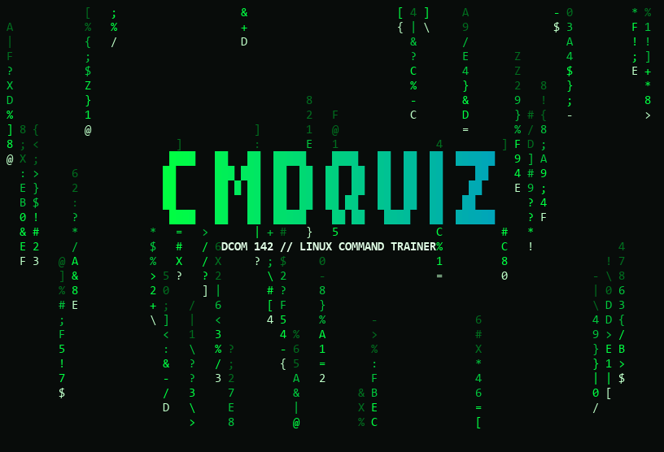
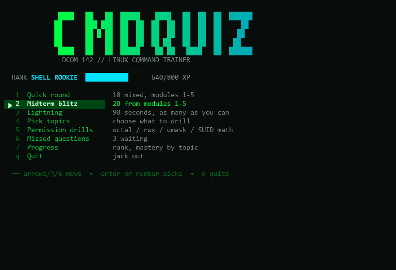
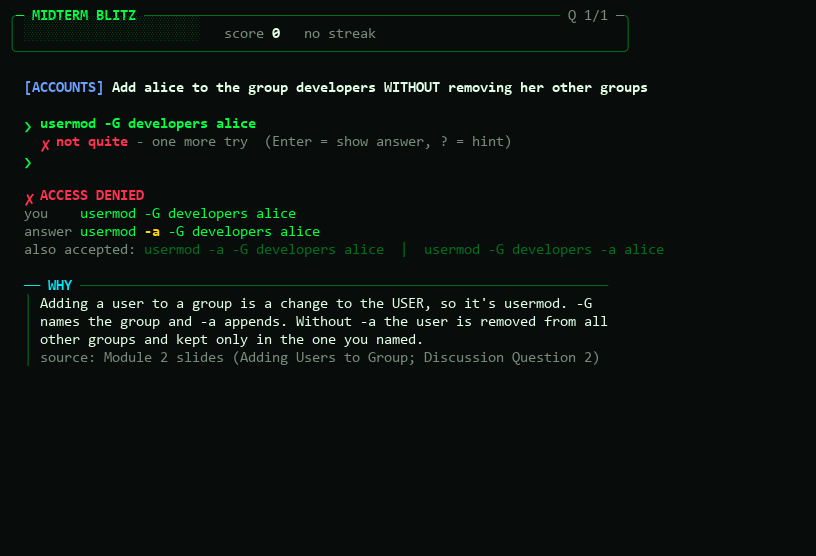
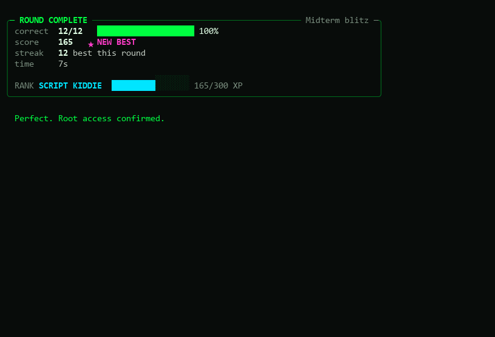
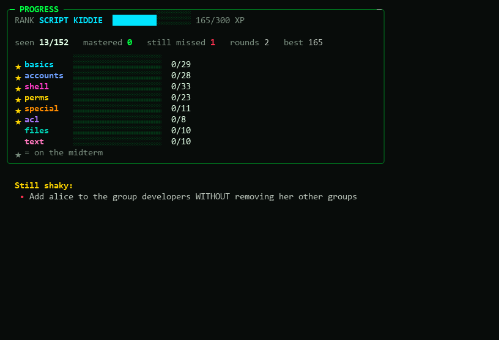
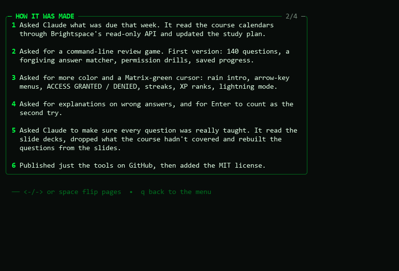

# dcom142-cmdquiz

A Matrix-themed terminal game for drilling the Linux commands from **DCOM 142** (Linux+ part 1, CompTIA Linux+ XK0-006) at the Community College of Baltimore County. You get a task, type the command from memory, and the game tells you exactly what you got wrong and why.



Built by a DCOM 142 student with [Claude Code](https://claude.com/claude-code) to study for the midterm. Read the full story in the **[case study](CASE_STUDY.md)**. Not affiliated with or endorsed by CCBC.

## Two ways to play

| | **[1. Live link](#option-1-live-link)** | **[2. Download](#option-2-download)** |
|---|---|---|
| **How** | Open a link in your browser | `git clone` it, then run it in a terminal |
| **Setup** | None | About 5 minutes the first time |
| **Works on** | Any computer, phones and tablets | Windows, Mac, Linux and Android (with Termux) |
| **Internet** | Needed | Not needed once downloaded |
| **Progress is saved** | In that browser | In the game's folder |
| **Best for** | Studying anywhere, right now | Practising in a real terminal |

Both are the same game: the same 152 questions, explanations, drills, streaks and ranks, graded exactly the same way.

## Option 1: Live link

### ▶ **[betzaleltusk.github.io/dcom142-cmdquiz](https://betzaleltusk.github.io/dcom142-cmdquiz/)**

Open it and play. Nothing to install. On a phone, tap the menu options and tap the input line to type. The game runs in a simulated terminal right in the page.

## Option 2: Download

Download the game and run it in a real terminal. It's one Python file.

**Never used a terminal before? No problem.** Follow the steps for your computer and you'll be playing in about 5 minutes (most of that is waiting for installs). Every gray box is one command: click its copy button, paste it into the terminal, and press **Enter**.

- [Windows](#windows)
- [Mac](#mac)
- [Android (Termux)](#android-termux)
- [Playing](#playing)
- [If something goes wrong](#if-something-goes-wrong)

<sub>Needs Git and Python 3.8 or newer, nothing else. Works on Windows, macOS and Linux.</sub>

### Windows

**1. Open a terminal.** Press the **Windows key**, type `terminal` and press **Enter**. (No "Terminal" app? Type `cmd` instead.)

**2. Install Git and Python.** Paste these one at a time, pressing **Enter** after each. If Windows asks *"Do you want to allow this app to make changes?"*, click **Yes**. Already have both? Skip to step 3.

```
winget install -e --id Git.Git --accept-source-agreements --accept-package-agreements
```
```
winget install -e --id Python.Python.3.13 --accept-source-agreements --accept-package-agreements
```

When both say they're done, **close the terminal and open a new one** (step 1 again). A fresh terminal is what lets it find Git and Python.

**3. Download the game and play:**

```
git clone https://github.com/BetzalelTusk/dcom142-cmdquiz
```
```
cd dcom142-cmdquiz
```
```
python cmdquiz.py
```

That's it. 🎉 **Next time** you just open a terminal and run:

```
cd dcom142-cmdquiz
```
```
python cmdquiz.py
```

### Mac

**1. Open Terminal.** Press **Command (⌘) + Space**, type `Terminal` and press **Enter**.

**2. Get Git and Python.** Run this:

```
git --version
```

If a window pops up saying the command needs the **command line developer tools**, click **Install** and wait for it to finish. That one install gives you both Git and Python. If you see a version number instead, you already have them.

**3. Download the game and play:**

```
git clone https://github.com/BetzalelTusk/dcom142-cmdquiz
```
```
cd dcom142-cmdquiz
```
```
python3 cmdquiz.py
```

**Next time:** open Terminal, then `cd dcom142-cmdquiz` and `python3 cmdquiz.py`.

### Android (Termux)

*Just want to play on your phone? The [live link](#option-1-live-link) is easier. This is for running the real terminal version.*

**1. Install Termux.** Get it from **[F-Droid](https://f-droid.org/packages/com.termux/)**, the source the Termux developers recommend. Open it once it's installed.

**2. Install Git and Python.** Run these one at a time. If it stops to ask about a config file, just press **Enter** to keep the default.

```
pkg upgrade -y
```
```
pkg install -y git python
```

**3. Download the game and play:**

```
git clone https://github.com/BetzalelTusk/dcom142-cmdquiz
```
```
cd dcom142-cmdquiz
```
```
python cmdquiz.py
```

**Tips for phones:**
- The **arrow keys** are in the extra row of keys above the keyboard. You can also press the **number** of a menu option.
- **Pinch to zoom out** or turn your phone sideways for more room. The game fits itself to the screen either way.

**Next time:** open Termux, then `cd dcom142-cmdquiz` and `python cmdquiz.py`.

### Getting updates

When the game gets new questions or fixes, go into the folder and pull the latest version. Your progress is kept.

```
cd dcom142-cmdquiz
```
```
git pull
```

### Playing

*These controls work the same in both versions. In the live link you can also tap menu options instead of using the keys.*

The game gives you a task, like *"Add alice to the group developers WITHOUT removing her other groups"*, and you type the Linux command that does it.

> **Type your answers into the game, not straight into the terminal.** Windows on its own doesn't understand Linux commands like `groupadd`. The game checks your answers itself, so it works on any computer.

| Key | What it does |
|---|---|
| **↑ / ↓**, then **Enter** | Move around the menus (or press the option's number) |
| Type your answer, then **Enter** | Submit an answer |
| `?` | Get a hint |
| **Enter** on an empty line *after a wrong answer* | Show the answer (counts as your second try) |
| `skip` | Give up and see the answer |
| `q` | End the round, or quit from the main menu |
| **Ctrl + C** | Emergency exit, works anywhere |

**Good places to start:** **Permission drills** (chmod and umask number practice) and **Midterm blitz** (20 questions from Modules 1-5). Typing `sudo` in front is optional, and `-la` counts the same as `-al`.

**Options:** add these after `cmdquiz.py`, e.g. `python cmdquiz.py --no-intro`.

| Option | Effect |
|---|---|
| `--no-intro` | skip the digital-rain intro |
| `--no-anim` | turn off all animation |
| `--plain` | plain text, for terminals that show boxes instead of symbols |

### If something goes wrong

| What you see | What to do |
|---|---|
| `git` or `python` *is not recognized* right after installing | Close the terminal and open a new one. Only new terminals see new installs. |
| `winget` *is not recognized* | Install **App Installer** from the Microsoft Store, then try again. Or install Git from [git-scm.com](https://git-scm.com/download/win) and Python from [python.org](https://www.python.org/downloads/) (tick **"Add python.exe to PATH"**). |
| Typing `python` opens the Microsoft Store | Python isn't installed yet, or this terminal was open before the install. Do Windows step 2, then open a new terminal. |
| `destination path 'dcom142-cmdquiz' already exists` | You already downloaded it. Run `cd dcom142-cmdquiz` and play, or run `git pull` to update. |
| `can't open file ... cmdquiz.py` | You're not in the game's folder. Run `cd dcom142-cmdquiz` first. |
| Boxes or question marks instead of symbols | Run `python cmdquiz.py --plain`. |
| Colors look wrong or the screen flickers | Run `python cmdquiz.py --no-anim`, or use the free **Windows Terminal** app from the Microsoft Store. |
| Installs are blocked (e.g. a school computer) | Use your own computer. |
| You want to reset your progress | Delete `.cmdquiz_progress.json` inside the `dcom142-cmdquiz` folder. |

Still stuck? [Open an issue](https://github.com/BetzalelTusk/dcom142-cmdquiz/issues) and describe what you see.

### What you just typed (optional reading)

Those commands use the same **command, option, argument** pattern from Module 1:

| You typed | What it did | DCOM 142 connection |
|---|---|---|
| `winget install ...` | A **package manager** downloaded and installed software | Linux has the same idea with `dnf` and `apt`, covered later in the course |
| `git clone <address>` | Copied the whole project from GitHub onto your computer | |
| `cd dcom142-cmdquiz` | Moved the terminal into that folder | `cd`, Module 1 |
| `python cmdquiz.py` | Ran a program and gave it a file as an **argument** | Like `cat notes.txt` |
| `python cmdquiz.py --plain` | The same, with an **option** | Like `ls -la` |

## How it plays



- **Arrow keys** (or j/k) and Enter move through the menus, or press the option's number.
- **Type the command** at the green prompt. Your text and cursor are Matrix green. Typing `sudo` is optional, quote style doesn't matter, and `-la` counts the same as `-al`, but argument order does matter (`chown file alice` is wrong).
- **One retry.** A wrong answer gets one more try. Press **Enter** on that second try to see the answer straight away. `?` gives a hint and `skip` reveals the answer.
- **On a miss** you get a word-by-word comparison (green matches, red is what you typed wrong, yellow is what was expected), the accepted alternatives, an explanation, and the slide it comes from.



**Modes:**
- **Quick round:** 10 mixed questions.
- **Midterm blitz:** 20 questions from Modules 1-5.
- **Lightning:** 90 seconds, as many as you can.
- **Pick topics:** a checklist of topics to drill.
- **Permission drills:** endless generated octal / rwx / symbolic chmod / umask / SUID-SGID math, with the working shown step by step.
- **Missed questions:** only the ones you've gotten wrong.
- **About:** four pages on what the game is, how it was made, the numbers, and what the testing caught.

Missed questions come up more often; a question counts as mastered after you get it right twice in a row. Streaks earn bonus points and XP moves you up six ranks, from Script Kiddie to Kernel Hacker.




## Where the questions come from

All **152 questions** are from the Fall 2026 DCOM 142 course itself: the instructor's Module 1-6 slide decks and their in-class exercises, the Module Learning Objectives pages, and the midterm review deck. Each question records its source, which is shown with the explanation.

| Topic | Course module | Questions |
|---|---|---|
| basics | Module 1: Linux basics, Vim/nano, su/sudo, troubleshooting method | 29 |
| accounts | Module 2: users, groups, /etc/passwd, /etc/shadow, /etc/group, PAM, login history | 28 |
| shell | Module 3: prompt and profile files, variables, chage/passwd policy, sudoers, wheel, polkit | 33 |
| perms | Module 4: chmod (octal and symbolic), umask, chown/chgrp, chattr/lsattr | 23 |
| special | Module 5: SUID, SGID, sticky bit | 11 |
| acl | Module 5: getfacl / setfacl | 8 |
| files, text | Module 6 (taught after the midterm): links, find, stat, echo, tr, wc, sort, cut, sdiff, awk, sed | 20 |

Module 6 questions stay out of the default rounds until you pick them under **Pick topics**.

The repo does **not** include any course files (slides, syllabi, textbook material). The questions and explanations are written from scratch and point to the slide rather than copying it.

## How it was made with Claude

The short version is below; the **[case study](CASE_STUDY.md)** has the whole story, including what the checks caught and the lessons learned. The game's **About** screen has a summary too.



This was built in one long conversation in the Code tab of the Claude desktop app, with Claude (Opus 5.5 and Sonnet 5.5) writing the code and the student directing, playing and giving feedback.

1. **Starting point.** The session began with the student asking what was due that week. Claude read the course calendars and assignments through Brightspace's read-only API in the app's built-in browser, after the student signed in themselves, and updated a study plan.
2. **First version.** The student asked for a command-line review game to learn the syntax of the commands they needed. Claude wrote a standard-library Python quiz with a command matcher that accepts real-world variations (optional `sudo`, any quote style, flag letters in any order).
3. **Iterating on feedback.** The student asked for:
   - more color and interactivity, plus a Matrix-green cursor and input (which became the rain intro, arrow-key menus, animations, streaks and ranks);
   - explanations for wrong answers;
   - Enter to count as the second attempt.
4. **Checking against the course.** The student asked Claude to make sure every question was actually covered in DCOM 142. Claude pulled the current slide decks and objectives pages through the same read-only API and read them. It then:
   - removed the questions the course hadn't taught (package management, storage, `man -k`, the sticky bit's octal digit and others);
   - added commands the slides do teach (`usermod -e`, `getent`, `killall -u`, `chage -m/-M/-W`, `sudoedit`, `pkexec`, the in-class chmod exercises and more);
   - confirmed each question's key command or phrase in the deck it cites.

   That pass also caught a slide typo: the deck lists `chmod -r` for recursive, but the real option is `-R`.

**How it was tested.** At each step Claude ran checks before handing anything back:
- unit tests on the answer matcher;
- permission math compared against Python's own `stat.filemode` for all 4,096 modes;
- scripted keystroke sessions through every menu, plus a perfect-play bot;
- forced-interactive runs replayed through a tiny terminal emulator.

The screenshots above come from that emulator. The checks caught real bugs along the way, such as a "try again" message that didn't actually allow a retry and a hint that gave away one-character answers.

## Academic integrity

This is a self-study tool. The DCOM 142 syllabus does not allow AI tools on graded work, so don't use this, or any AI, during a quiz, exam, Live Lab or Applied Live Lab.

## License

[MIT](LICENSE)
